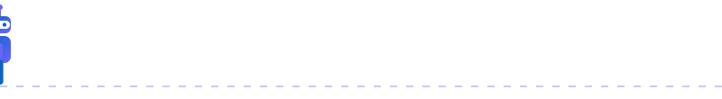

 

I am a technology student focused on building practical, real-world solutions using Artificial Intelligence, Machine Learning, and Data Analytics. I enjoy turning ideas into working systems that combine data, automation, and intelligent decision-making. My goal is to grow into a proficient AI/Data professional through continuous, hands-on learning and project-building.

---

## About Me

> **I turn data into decisions and ideas into working systems.**

I'm a technology student who learns by building. Every project I take on goes from raw data to a live, usable interface, and each one teaches me something the last one didn't.

**What I do**

- 🔹 **Build end-to-end AI applications**, from data pipelines to deployed interfaces
- 🔹 **Work across the stack**: data processing, model integration, and Streamlit/Gradio front ends
- 🔹 **Write clean, readable, maintainable code** that others can pick up easily
- 🔹 **Go deeper every day** into Machine Learning, Deep Learning, and Generative AI

**Let's connect**

I'm open to collaborating on AI, data, and Python-based projects. If you have an idea worth building, I'd love to hear it.

---

## Featured Projects

**[IntelliFlow Logistics AI Copilot](https://github.com/nihaaarika/IntelliFlow-Logistics-AI-Copilot)**
Real-time logistics intelligence system with AI-powered insights and predictive analytics, built using Pathway streaming, FastAPI, and Streamlit. Developed for the IIT Ropar Gen AI Hackathon 2025.

**[Goal Detector](https://github.com/nihaaarika/Goal-detector)**
An AI-powered goal and career discovery assistant for students. Guides users through a structured questionnaire, interprets their interests and goals, and generates personalized recommendations.

**[PhishShield](https://github.com/nihaaarika/PhishShield)**
A multi-class NLP-based scam detection system that classifies messages as phishing, OTP fraud, lottery scams, job scams, or safe content, with an associated risk score.

**[AI Story Generator](https://github.com/nihaaarika/AI-story-generator)**
A Gradio application that generates illustrated, narrated folk stories rooted in rural Indian culture, combining generative text, image, and audio pipelines.

**[NOTES_CLONE](https://github.com/nihaaarika/NOTES_CLONE)**
A Streamlit-based productivity application with journaling and note-taking features, including a customizable UI with font and background selection.

Visit my [repositories](https://github.com/nihaaarika?tab=repositories) for the full list of projects and progress.

---

## Technical Skills

**Languages & Core Tools**
Python, SQL (learning), Git and GitHub

**AI & Data**
Machine Learning, Deep Learning (fundamentals), Natural Language Processing, Data Analysis, Data Visualization

**Libraries & Frameworks**
NumPy, Pandas, Matplotlib, Scikit-learn, Streamlit, Gradio, LangChain

**Tools & Platforms**
FastAPI, Pathway, Hugging Face, Google Gemini API

---

## Current Learning Focus

- Model building, evaluation, and end-to-end ML pipelines
- Working with real-world datasets and feature engineering
- Retrieval-augmented generation and LLM-based application design
- Deployment of AI models using Streamlit and Gradio

---

